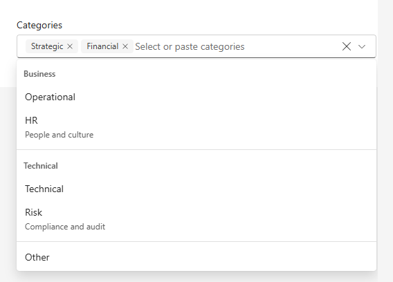

# TagPicker control

The TagPicker control is a Fluent UI v9 tag picker for selecting one or many values from a set of options. It adds option grouping, search filtering, select all / clear all actions, a selection limit, paste-to-add with optional free-form entries, and full slot-level customization on top of Fluent's native `TagPicker` primitives.



## How to use this control

- Import the control into your component:

```tsx
import * as React from 'react';
import { TagPicker } from '@pnp/spfx-controls-react/lib/TagPicker';
import type { ITagPickerOption } from '@pnp/spfx-controls-react/lib/TagPicker';

const options: ITagPickerOption[] = [
  { key: 'strategic', text: 'Strategic' },
  { key: 'financial', text: 'Financial', secondaryText: 'Budget and forecasting' },
  { key: 'operational', text: 'Operational' },
  { key: 'legal', text: 'Legal', disabled: true },
];

export const Example = (): React.ReactElement => (
  <TagPicker
    label="Categories"
    placeholder="Select categories"
    options={options}
    defaultSelectedOptions={['strategic']}
    onSelectionChange={(data) => console.log(data.selectedOptions)}
  />
);
```

When no ambient `FluentProvider` is present, the control wraps itself in a `FluentProvider` using the supplied `theme` (or `webLightTheme` by default). When the control is rendered inside an existing `FluentProvider` and no `theme` is supplied, the host theme is used as-is.

## Controlled selection

Provide `selectedOptions` and `onSelectionChange` to fully control the selected keys:

```tsx
const [selected, setSelected] = React.useState<string[]>([]);

<TagPicker
  label="Owners"
  options={options}
  selectedOptions={selected}
  onSelectionChange={(data) => setSelected(data.selectedOptions)}
/>
```

`onSelectionChange` receives the selected keys, the resolved option objects, and the `reason` for the change (`'option'`, `'dismiss'`, `'clear'`, `'selectAll'`, or `'paste'`).

## Grouped options

Assign a `groupKey` to options and describe the groups with `groups`. Options with an unknown or missing `groupKey` are rendered after the groups.

```tsx
<TagPicker
  label="Categories"
  groups={[
    { key: 'business', label: 'Business' },
    { key: 'technical', label: 'Technical' },
  ]}
  options={[
    { key: 'strategic', text: 'Strategic', groupKey: 'business' },
    { key: 'hr', text: 'HR', groupKey: 'business' },
    { key: 'technical', text: 'Technical', groupKey: 'technical' },
    { key: 'other', text: 'Other' },
  ]}
/>
```

## Single selection, limits, and scrolling

```tsx
<TagPicker mode="single" label="Primary category" options={options} />

<TagPicker
  label="Up to three tags"
  options={options}
  maxSelections={3}
  maxSelectedItemsHeight={96}
/>
```

In `single` mode the last chosen value replaces the current selection and the select all / clear all actions are hidden. When `maxSelections` is reached the input becomes read-only and the list shows `selectionLimitReachedText` until a tag is removed; focus and keyboard navigation to the selected tags are preserved. `maxSelectedItemsHeight` constrains the selected tag area and makes it scrollable.

## Paste and free-form values

Pasted text is split by `pasteDelimiter` (new lines, commas, semicolons, and tabs by default). Each value is matched case-insensitively against option keys and texts; duplicates within a single paste are collapsed. With `allowFreeform`, unmatched values are added as new options and selected; use `getPasteOption` to shape them. Free-form options only exist while they are selected — removing the tag removes the option from the list as well.

```tsx
<TagPicker
  label="Recipients"
  options={options}
  allowFreeform
  pasteDelimiter={/[\s,;]+/}
  getPasteOption={(value) => ({ key: value.toLowerCase(), text: value })}
/>
```

## Custom rendering

```tsx
<TagPicker
  label="People"
  options={people}
  renderOption={(option) => <PersonaRow person={option.data} />}
  renderTag={(option) => option.text.toUpperCase()}
  renderGroupHeader={(group) => <strong>{group.label}</strong>}
  renderSecondaryAction={({ canClear, clear }) => (
    <Button size="small" appearance="subtle" disabled={!canClear} onClick={clear}>Reset</Button>
  )}
  renderExpandIcon={({ open }) => (open ? <ChevronUpRegular /> : <ChevronDownRegular />)}
/>
```

## Localization

Built-in UI text comes from the library's `ControlStrings` resources, so it follows the page language automatically. Pass a `strings` object to override it in one place; any key you omit keeps the library default. The individual `placeholder`, `noOptionsText`, `selectAllLabel`, `clearAllLabel`, `selectedItemsAriaLabel`, and `selectionLimitReachedText` props take precedence over `strings` when both are supplied.

```tsx
import * as strings from 'MyWebPartStrings';

<TagPicker
  label={strings.CategoriesLabel}
  options={options}
  strings={{
    placeholder: strings.CategoriesPlaceholder,
    noOptionsText: strings.CategoriesNoOptions,
    selectAllLabel: strings.SelectAll,
    clearAllLabel: strings.ClearAll,
    selectedItemsAriaLabel: strings.CategoriesSelectedValues,
    selectionLimitReachedText: strings.CategoriesLimitReached,
  }}
/>
```

## Implementation

The `TagPicker` control can be configured with the following properties:

| Property | Type | Required | Description |
| --- | --- | --- | --- |
| options | `ITagPickerOption<TData>[]` | Yes | Options available for selection. |
| groups | `ITagPickerGroupDescriptor[]` | No | Group descriptors used to render `TagPickerOptionGroup` sections. Options are matched by `groupKey`. |
| mode | `'single' \| 'multiple'` | No | Selection mode. Defaults to `'multiple'`. |
| selectedOptions | `string[]` | No | Selected option keys (controlled). |
| defaultSelectedOptions | `string[]` | No | Initially selected option keys (uncontrolled). |
| onSelectionChange | `(data: ITagPickerSelectionChangeData<TData>) => void` | No | Called whenever the selection changes. Not called when the resulting selection is identical to the current one. |
| theme | `Theme` | No | Fluent UI v9 theme. When omitted, the ambient `FluentProvider` theme is used, or `webLightTheme` if none exists. |
| label | `FieldProps['label']` | No | Field label. |
| required | `boolean` | No | Marks the field as required. |
| validationMessage | `FieldProps['validationMessage']` | No | Validation message shown below the control. |
| validationState | `FieldProps['validationState']` | No | Validation state applied to the field. |
| hint | `FieldProps['hint']` | No | Hint text shown below the control. |
| fieldProps | `Omit<FieldProps, ...>` | No | Additional Fluent UI `Field` properties. |
| strings | `ITagPickerStrings` | No | Localized UI text. Omitted keys fall back to the library `ControlStrings` defaults. |
| placeholder | `string` | No | Input placeholder. Defaults to `'Select values'`. |
| noOptionsText | `string` | No | Text shown when no options match. Defaults to `'No matching options'`. |
| selectAllLabel | `string` | No | Accessible label for the select all button. Defaults to `'Select all'`. |
| clearAllLabel | `string` | No | Accessible label for the clear all button. Defaults to `'Clear all'`. |
| selectedItemsAriaLabel | `string` | No | Accessible label for the selected tag group. Defaults to `'<label> selected values'`. |
| selectionLimitReachedText | `string` | No | Text shown in the list when `maxSelections` is reached. Defaults to `'Selection limit reached'`. |
| disabled | `boolean` | No | Disables the control. Defaults to `false`. |
| maxSelections | `number` | No | Maximum number of selected values in `multiple` mode. When reached, the input becomes read-only and the list shows `selectionLimitReachedText`. |
| maxSelectedItemsHeight | `number \| string` | No | Maximum height of the selected tag area; enables vertical scrolling. |
| clearable | `boolean` | No | Shows the clear all action in `multiple` mode. Defaults to `true`. |
| enablePaste | `boolean` | No | Enables paste-to-add. Defaults to `true`. |
| pasteDelimiter | `string \| RegExp` | No | Delimiter used to split pasted text. Defaults to `/[\n,;\t]+/`. |
| allowFreeform | `boolean` | No | Adds unmatched pasted values as new options. Free-form options are removed once deselected. Defaults to `false`. |
| filterOption | `(option, query) => boolean` | No | Custom filter predicate. Replaces the default text / secondary text match. Receives the raw, untrimmed query (the default filter trims and lower-cases it). |
| renderOption | `(option) => React.ReactNode` | No | Custom option content. |
| renderGroupHeader | `(group) => React.ReactNode` | No | Custom group header content. |
| renderTag | `(option) => React.ReactNode` | No | Custom selected tag content. |
| renderSelectAllButton | `(context: ITagPickerActionRenderContext<TData>) => React.ReactNode` | No | Replaces the default select all button. |
| renderClearAllButton | `(context: ITagPickerActionRenderContext<TData>) => React.ReactNode` | No | Replaces the default clear all button. |
| renderSecondaryAction | `(context: ITagPickerActionRenderContext<TData>) => React.ReactNode` | No | Replaces the entire secondary action slot. |
| renderExpandIcon | `(context: ITagPickerExpandIconRenderContext) => React.ReactNode` | No | Custom expand icon. |
| getPasteOption | `(value: string) => ITagPickerOption<TData>` | No | Creates the option for an unmatched pasted value when `allowFreeform` is enabled. |
| onQueryChange | `(query: string) => void` | No | Called when the search text changes. |
| className | `string` | No | Class name applied to the root element. |
| classNames | `ITagPickerClassNames` | No | Class names for individual slots. |
| styles | `ITagPickerStyles` | No | Inline styles for individual slots. |
| tagPickerProps | `Omit<TagPickerProps, ...>` | No | Additional Fluent UI `TagPicker` properties (for example `open`, `defaultOpen`, `positioning`, `size`). |
| controlProps | `TagPickerControlProps` | No | Additional Fluent UI `TagPickerControl` properties. |
| inputProps | `Omit<TagPickerInputProps, ...>` | No | Additional Fluent UI `TagPickerInput` properties. |
| selectedGroupProps | `TagPickerGroupProps` | No | Additional Fluent UI `TagPickerGroup` properties. |
| listProps | `TagPickerListProps` | No | Additional Fluent UI `TagPickerList` properties. |
| optionGroupProps | `Omit<TagPickerOptionGroupProps, ...>` | No | Additional Fluent UI `TagPickerOptionGroup` properties. |
| optionProps | `Omit<TagPickerOptionProps, ...>` | No | Additional Fluent UI `TagPickerOption` properties. |

### ITagPickerStrings

| Property | Type | Default | Description |
| --- | --- | --- | --- |
| placeholder | `string` | `'Select values'` | Input placeholder. |
| noOptionsText | `string` | `'No matching options'` | Text shown when no options match the query. |
| selectAllLabel | `string` | `'Select all'` | Accessible label and tooltip of the select all button. |
| clearAllLabel | `string` | `'Clear all'` | Accessible label and tooltip of the clear all button. |
| selectedItemsAriaLabel | `string` | `'<label> selected values'` | Accessible label of the selected tag group. |
| selectionLimitReachedText | `string` | `'Selection limit reached'` | Text shown in the list when `maxSelections` is reached. |

### ITagPickerOption

| Property | Type | Required | Description |
| --- | --- | --- | --- |
| key | `string` | Yes | Unique key of the option. |
| text | `string` | Yes | Display text; also used for filtering and paste matching. |
| secondaryText | `string` | No | Secondary line shown below the text; included in filtering. |
| groupKey | `string` | No | Key of the group the option belongs to. |
| disabled | `boolean` | No | Excludes the option from the list and from select all. |
| media | `React.ReactNode` | No | Media (icon or avatar) shown in the option and its tag. |
| data | `TData` | No | Arbitrary payload returned in `selectedItems`. |

### ITagPickerSelectionChangeData

| Property | Type | Description |
| --- | --- | --- |
| selectedOptions | `string[]` | Selected option keys. |
| selectedItems | `ITagPickerOption<TData>[]` | Resolved option objects for the selected keys. |
| reason | `'option' \| 'dismiss' \| 'clear' \| 'selectAll' \| 'paste'` | What triggered the change. |

### ITagPickerActionRenderContext

| Property | Type | Description |
| --- | --- | --- |
| selectedOptions | `string[]` | Selected option keys. |
| selectedItems | `ITagPickerOption<TData>[]` | Resolved selected options. |
| canSelectAll | `boolean` | Whether select all is currently possible. |
| canClear | `boolean` | Whether clear all is currently possible. |
| selectAll | `() => void` | Selects all enabled options. |
| clear | `() => void` | Clears the selection. |

### Class name and style slots

`classNames` and `styles` accept the following slot keys: `root`, `field`, `control`, `input`, `selectedGroup`, `selectedTag`, `selectedTagContent`, `list`, `optionGroup`, `option`, `optionContent`, `optionSecondary`, `secondaryAction`, `selectAllButton`, `clearAllButton`, `expandIcon`, and `noOptions`.

## Imperative API

Use an `ITagPickerHandle` ref to focus the input, clear or select all values, or set the search text:

```tsx
import { Button } from '@fluentui/react-components';
import { ITagPickerHandle, TagPicker } from '@pnp/spfx-controls-react/lib/TagPicker';

const pickerRef = React.useRef<ITagPickerHandle>(null);

<TagPicker ref={pickerRef} label="Tags" options={options} />
<Button onClick={() => pickerRef.current?.focus()}>Focus</Button>
<Button onClick={() => pickerRef.current?.selectAll()}>Select all</Button>
<Button onClick={() => pickerRef.current?.clear()}>Clear</Button>
<Button onClick={() => pickerRef.current?.setQuery('fin')}>Search</Button>
```

## Accessibility

The control preserves Fluent UI keyboard navigation, listbox semantics, and tag dismissal behavior. The selected tag group, select all, and clear all actions expose configurable accessible labels through `selectedItemsAriaLabel`, `selectAllLabel`, and `clearAllLabel`.


